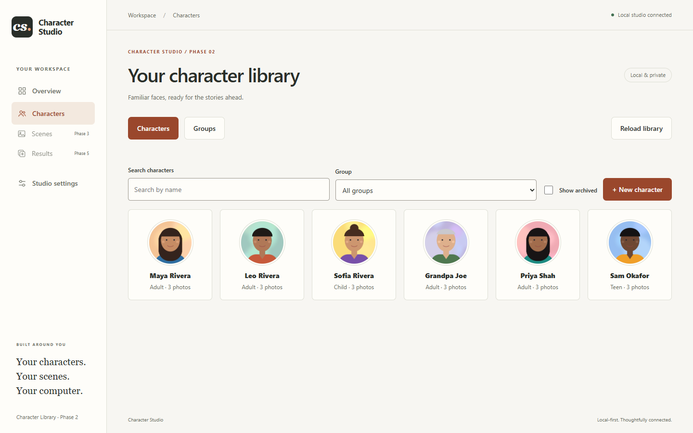
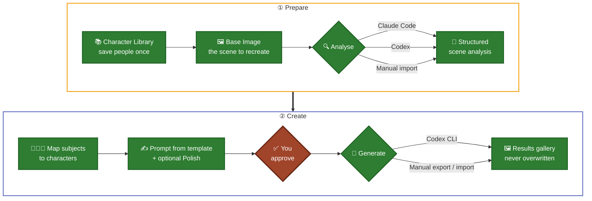
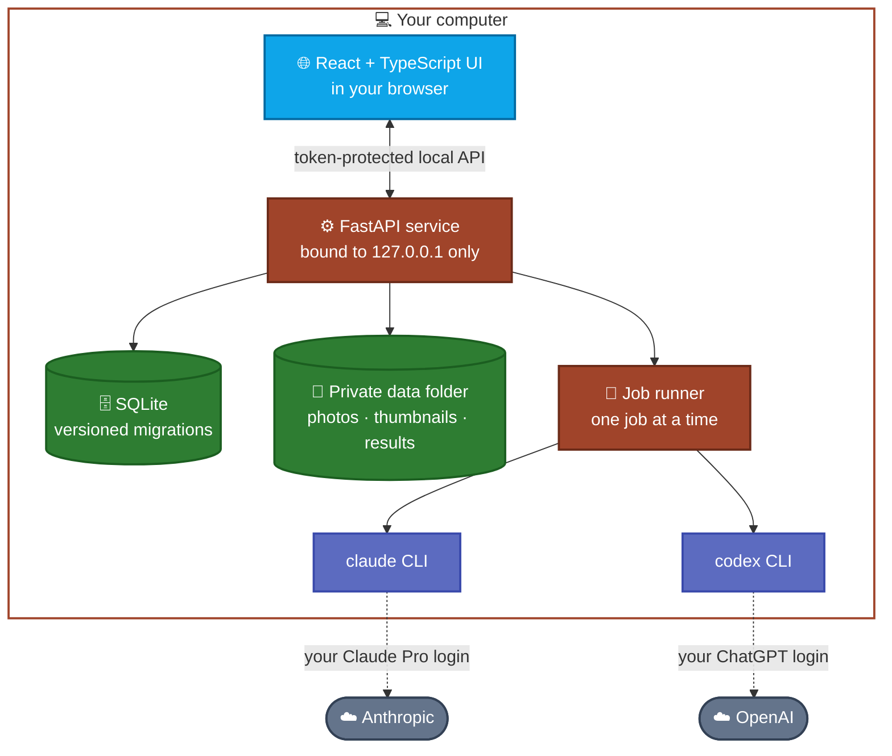
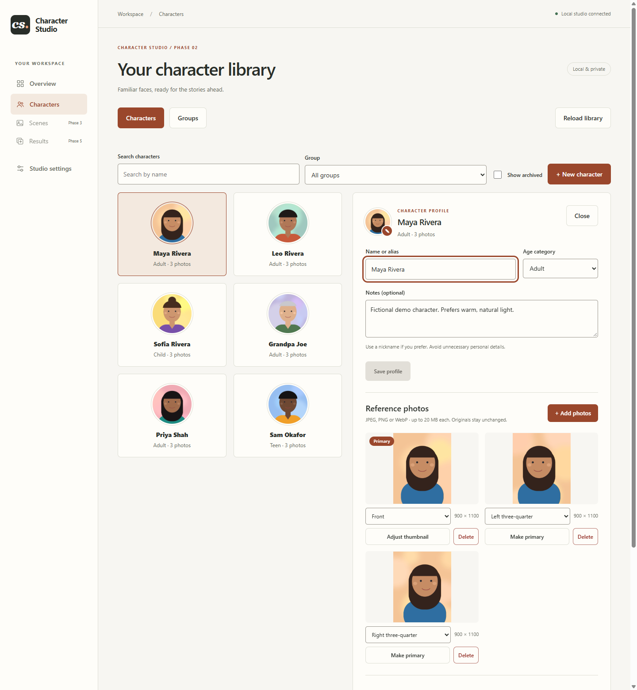
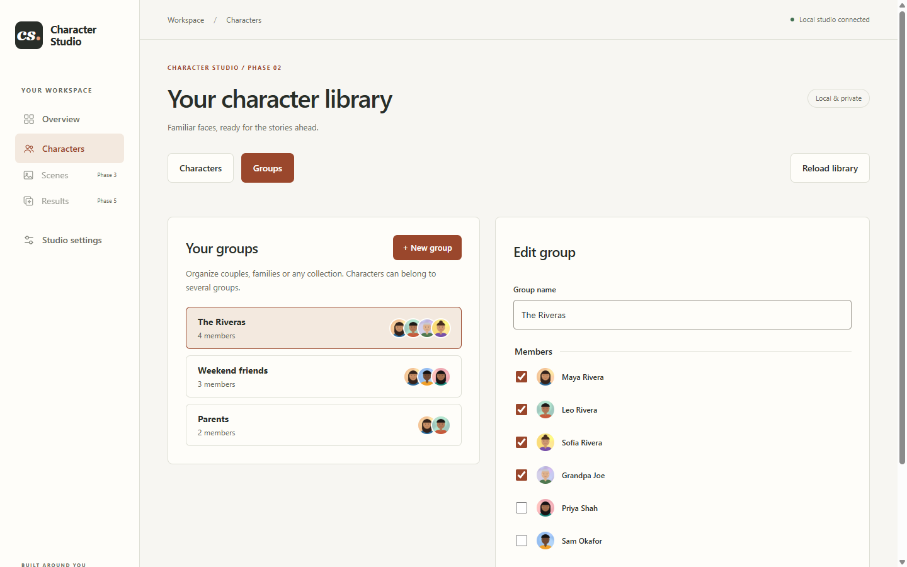
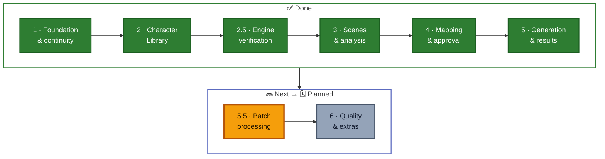

<div align="center">

# 🎭 Character Studio

**Recreate any scene with the people you care about, privately, on your own computer.**

Save your characters once, pick a reference scene, approve the prompt, and let the AI tools you already subscribe to do the rest.

[](https://github.com/CyberSecurityChuck/Character-Studio/actions/workflows/ci.yml)
[](LICENSE)
[](#-roadmap)
[](#-quick-start)
<br/>
[](https://www.python.org/)
[](https://fastapi.tiangolo.com/)
[](https://react.dev/)
[](https://www.typescriptlang.org/)
[](https://www.sqlite.org/)
[](#-privacy-by-design)
[](#-how-the-ai-part-works)

<br/>



<sub>Screenshots use fictional demo characters with illustrated portraits.</sub>

</div>

---

> [!NOTE]
> **Early development.** The **Character Library** (Phases 1–2), **Scenes & AI analysis** (Phase 3) and **character mapping, prompt polishing and approval** (Phase 4) and **generation & results** (Phase 5) work today. Batch processing comes next. See the [roadmap](#-roadmap).

## ✨ Why Character Studio?

Recreating a photo with different people usually means re-uploading the same reference photos and rewriting long prompts every time, while juggling several apps. Character Studio keeps it all in one place:

- 📚 **Save each person once.** Reuse their reference photos in every scene.
- 🧭 **Composition and identity stay separate.** The scene decides *how and where*; your character photos decide *who*.
- ✅ **Nothing generates without your approval** of the exact prompt, photos and person-to-subject mapping.
- 🔒 **Everything stays on your computer.** Data leaves only when you click an AI action.
- 💸 **No API keys, no per-image billing.** It drives the official `claude` and `codex` command-line tools under your own subscriptions.

## 🧩 Features

| | Feature | Status |
|---|---|---|
| 📚 | Character profiles: name, age category, notes, search, archive/restore | ✅ Available |
| 🖼️ | Multiple reference photos per character, labels (front, ¾, profile…), primary photo | ✅ Available |
| 🎯 | Adjustable round thumbnails (drag and zoom; originals never altered) | ✅ Available |
| 👨‍👩‍👧 | Reusable groups: couples, families, friends | ✅ Available |
| ♻️ | Crash-safe storage: stale-edit protection, upload/delete recovery | ✅ Available |
| 🔍 | Scene upload and AI scene analysis (Claude or Codex, or manual), editable prompt | ✅ Available |
| 🧑‍🤝‍🧑 | Map people in the scene to saved characters, pick reference photos; optional "Polish prompt" | ✅ Available |
| ✅ | Review screen and approval snapshots that cancel themselves when any input changes | ✅ Available |
| 🎨 | One-click generation via Codex CLI from an approval, manual export/import, results gallery with Base Image comparison | ✅ Available |
| 📦 | Batch analysis and generation, multiple variations | 🗓️ Phase 5.5 |

## 🔄 How it works



<sub>🟩 Available · 🟥 Your Approval Gate</sub>

**The golden rule:** the *Base Image* is the authority on pose, camera angle, outfit, lighting and background. The *character photos* are the authority on identity only. The prompt template enforces this split, so a character's reference photos never change the scene's composition.

## 🤖 How the AI part works

*Analysis, prompt polishing and generation all work today.* Character Studio does **not** call paid AI APIs. When you click an AI action, it runs the **official command-line tools** you installed and signed into yourself, one job at a time, in a private job folder:

| Step | Default engine | Alternatives | Uses |
|---|---|---|---|
| 🔍 Scene analysis | **Claude Code** (`claude -p`) | Codex · Manual | Claude Pro plan |
| ✍️ Polish prompt (optional) | **Claude Code** (`claude -p`) | Keep template prompt | Claude Pro plan |
| 🎨 Image generation | **Codex CLI** (`codex exec`) | Manual export / import | ChatGPT plan with image generation |

- The studio **never reads, stores or forwards** your CLI logins, never scrapes websites and never uses unofficial endpoints or gateways.
- Every run has a **timeout and a Cancel button** and is **never retried automatically**.
- The **manual bridge** (copy the instruction, export a package, import the result) stays available as a fallback.

These choices were checked in a hands-on [engine verification spike](docs/PROVIDER_FINDINGS.md): real CLI flags, output locations, failure modes and folder confinement. The design rationale is in [DECISIONS.md](DECISIONS.md) (D009).

## 🏗️ Architecture



<sub>The CLIs run on your computer under your own sign-ins. The app itself has no cloud backend.</sub>

## 🔒 Privacy by design

| Stays on your computer | Leaves your computer only when you click |
|---|---|
| ✅ Character profiles, reference photos, thumbnails | 🔍 **Analyse** sends the scene image to Anthropic (or OpenAI if you pick Codex) |
| ✅ Scenes, prompts, approvals, results, history | ✍️ **Polish prompt** sends prompt text (no images) to Anthropic |
| ✅ The database and all logs | 🎨 **Generate** sends the scene and the chosen reference photos to OpenAI |

Only **Analyse** (the Base Image, with location data removed), **Polish prompt** (prompt and analysis text) and **Generate** (the Base Image and the approved reference photos, with location data removed) send anything, and only when you click them. Character names never go into the prompt or into the files Codex receives.

- 🏠 The server only listens on `127.0.0.1`, with host/origin checks and a per-session request token.
- 📂 Your data lives in a separate folder (default `%USERPROFILE%\Character-Studio-Data`), never inside the source code.
- 🧹 Thumbnails are stored without photo metadata. Location (GPS) data is stripped from every image before it is sent to an AI tool.
- 🙅 No analytics, no remote fonts, no telemetry.
- ⚠️ Local files are not encrypted, so anyone with access to your Windows account can read them.
- 🛡️ Git ignores photos, databases and logs, and CI runs a [privacy guard](.github/workflows/ci.yml) on every push.

## 🚀 Quick start

> [!IMPORTANT]
> Character Studio currently targets **Windows 10/11**.

**You need:** [Node.js 24 LTS](https://nodejs.org/) and [uv](https://docs.astral.sh/uv/). uv installs Python 3.12 for you.
For AI scene analysis and generation you will also need [Claude Code](https://docs.claude.com/en/docs/claude-code) with a Claude Pro plan and [Codex CLI](https://developers.openai.com/codex/cli) with a ChatGPT plan that includes image generation. The Character Library, manual analysis and manual export/import work without them.

```powershell
git clone https://github.com/CyberSecurityChuck/Character-Studio.git
cd Character-Studio
powershell -NoProfile -ExecutionPolicy Bypass -File .\scripts\Setup.ps1
```

Then double-click **`Start-Studio.cmd`**. The studio opens at <http://127.0.0.1:8765>. Use **`Stop-Studio.cmd`** to stop it.

📖 Full setup, configuration, troubleshooting and day-to-day use: **[User Guide](docs/USER_GUIDE.md)**.

## 📸 Screenshots

<table>
  <tr>
    <td width="50%"><br/><sub><b>Character profile</b>: labelled reference photos, primary photo, thumbnail framing</sub></td>
    <td width="50%"><br/><sub><b>Groups</b>: families, couples and friends, reusable across scenes</sub></td>
  </tr>
</table>

## 🗺️ Roadmap



Phase 6 ideas include region-based editing, identity and composition checks, and optional paid API engines (off by default). The full plan, with acceptance criteria for each phase, is in [PLAN.md](PLAN.md).

## 🛠️ Tech stack

| Layer | Technology |
|---|---|
| Frontend | React 19 · TypeScript · Vite |
| Backend | Python 3.12 · FastAPI · Pydantic |
| Storage | SQLite (SQLAlchemy + Alembic migrations) · local filesystem |
| Images | Pillow |
| AI engines | Claude Code CLI · Codex CLI (official, subscription-based) |
| Tooling | uv · npm · pytest · Ruff · GitHub Actions |

## 📁 Project layout

```text
backend/      FastAPI app, models, migrations, provider contracts
frontend/     React + TypeScript UI (Vite)
tests/        pytest suite (isolated temporary data, no network)
scripts/      Windows setup / start / stop scripts
docs/         User guide, provider findings, recovery, continuity, design
PLAN.md       Authoritative requirements and phased roadmap
DECISIONS.md  Architecture decision log
```

## 🧪 Development

```powershell
uv run --locked pytest              # tests
uv run --locked ruff check .        # lint
npm --prefix frontend run build     # type-check + production build
```

The project is built in small, approved phases and keeps continuity records ([PROJECT_STATUS](PROJECT_STATUS.md), [SESSION_HANDOFF](SESSION_HANDOFF.md), [CHANGELOG](CHANGELOG.md)), so any work session can be paused and resumed safely. It is developed with the help of AI coding assistants.

## 🤝 Responsible use

Character Studio works with real people's likenesses. **Only use photos of yourself or of people who have agreed**, take extra care with children, and never use it to deceive, impersonate or harass. Please read the **[Responsible Use policy](RESPONSIBLE_USE.md)**.

## 🔐 Security

Found a vulnerability? Please report it privately. See **[SECURITY.md](SECURITY.md)**.

## 📄 License

[MIT](LICENSE) © CyberSecurityChuck
