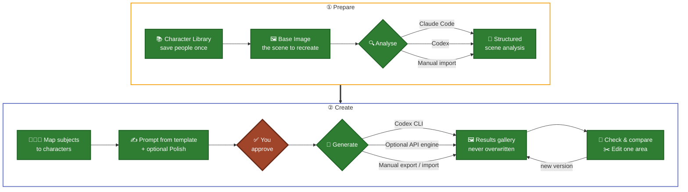
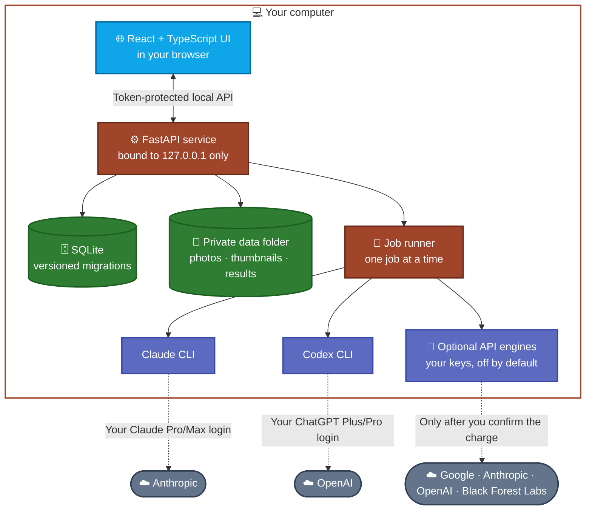
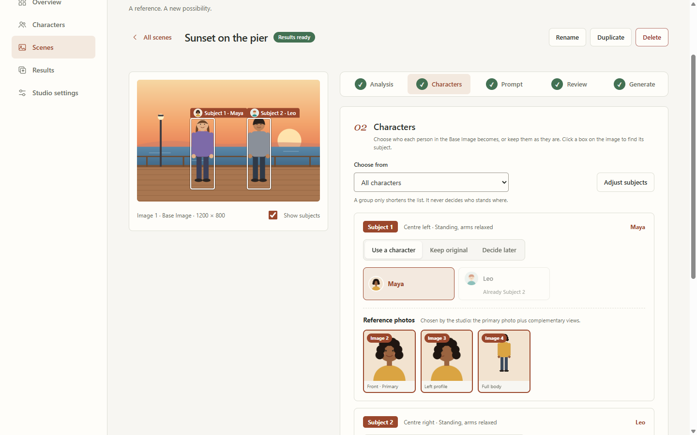
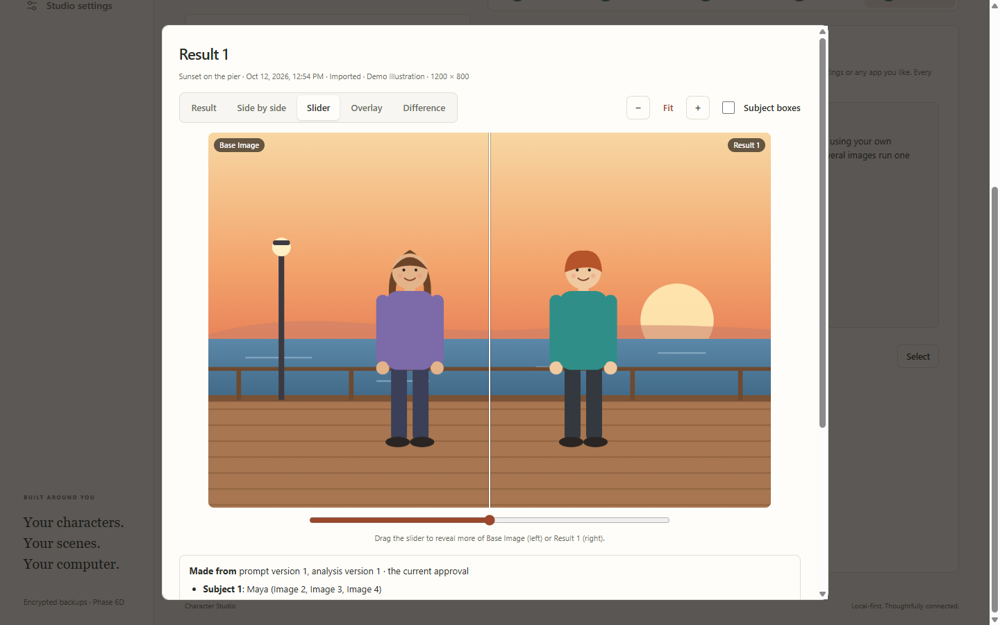
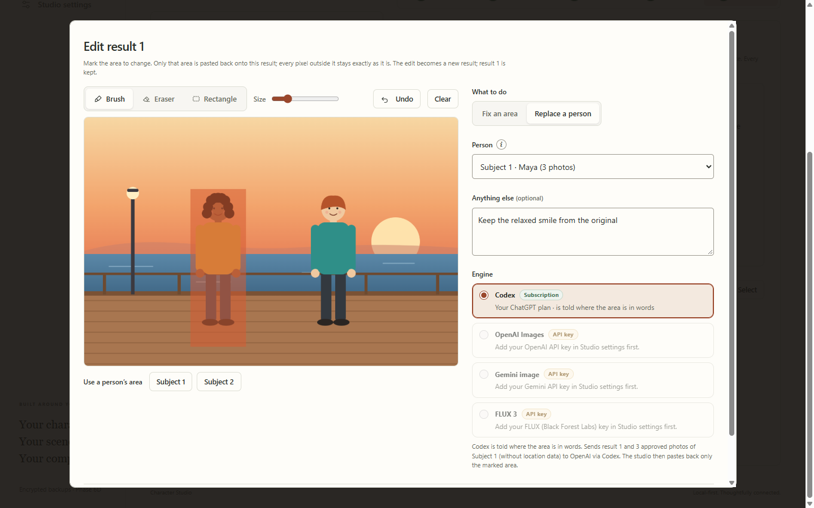
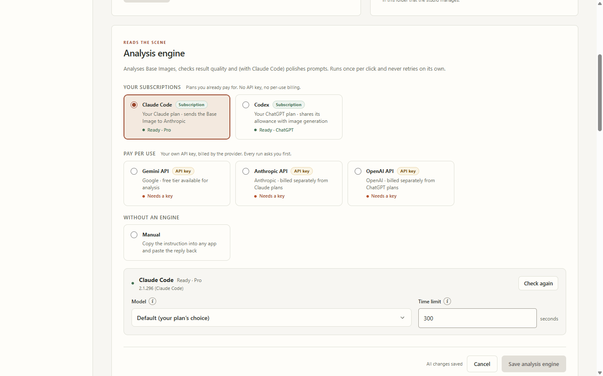
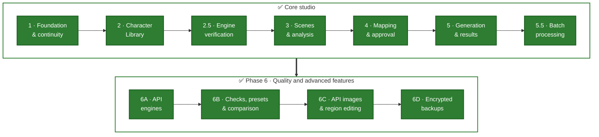

<div align="center">

# 🎭 Character Studio

**Recreate any scene with the people you care about, privately, on your own computer.**

Save your characters once, pick a reference scene, approve the prompt, and let the AI tools you already subscribe to do the rest.

[](https://github.com/CyberSecurityChuck/Character-Studio/actions/workflows/ci.yml)
[](LICENSE)
[](#-roadmap)
[](#-quick-start)
<br/>
[](https://www.python.org/)
[](https://fastapi.tiangolo.com/)
[](https://react.dev/)
[](https://www.typescriptlang.org/)
[](https://www.sqlite.org/)
[](#-privacy-by-design)
[](#-how-the-ai-part-works)

<br/>


<sub>Screenshots use fictional demo characters with illustrated portraits.</sub>

</div>

---

> [!NOTE]
> **All six planned phases are built and reviewed.** The Character Library, scene analysis, character mapping and approval, generation and results, batch processing, and Phase 6: optional API engines with your own keys, quality checks, comparison and presets, region editing and replacing one person, and password-protected backups. It is a personal project for Windows, developed in small reviewed phases. See the [roadmap](#-roadmap).

## ✨ Why Character Studio?

Recreating a photo with different people usually means re-uploading the same reference photos and rewriting long prompts every time, while juggling several apps. Character Studio keeps it all in one place:

- 📚 **Save each person once.** Reuse their reference photos in every scene.
- 🧭 **Composition and identity stay separate.** The scene decides *how and where*; your character photos decide *who*.
- ✅ **Nothing generates without your approval** of the exact prompt, photos and person-to-subject mapping.
- 🔒 **Everything stays on your computer.** Data leaves only when you click an AI action.
- 💸 **Your subscriptions first.** By default it drives the official `claude` and `codex` command-line tools under your own plans: no API keys, no per-image billing. Paid API engines are optional, off by default, and ask before every run.

## 🧩 Features

| | Feature | Status |
|---|---|---|
| 📚 | Character profiles: name, age category, notes, search, archive/restore | ✅ Available |
| 🖼️ | Multiple reference photos per character, labels (front, ¾, profile…), primary photo | ✅ Available |
| 🎯 | Adjustable round thumbnails (drag and zoom; originals never altered) | ✅ Available |
| 👨‍👩‍👧 | Reusable groups: couples, families, friends | ✅ Available |
| ♻️ | Crash-safe storage: stale-edit protection, upload/delete recovery | ✅ Available |
| 💾 | Consistent backups with per-file checks, optionally password-protected (AES-256); restore that never overwrites your data | ✅ Available |
| 🔍 | Scene upload and AI scene analysis (Claude or Codex, or manual), editable prompt | ✅ Available |
| 🧑‍🤝‍🧑 | Map people in the scene to saved characters, pick reference photos; optional "Polish prompt" | ✅ Available |
| ✅ | Review screen and approval snapshots that cancel themselves when any input changes | ✅ Available |
| 🎨 | One-click generation via Codex CLI from an approval, manual export/import, results gallery with Base Image comparison | ✅ Available |
| 📦 | Several scenes at once: upload, analyse and generate approved scenes in a queue that pauses at plan limits; several images per click; group suggestions | ✅ Available |
| 🔑 | Optional API engines with your own keys: analysis (Gemini, Anthropic, OpenAI) and image generation (Gemini image, OpenAI Images); keys encrypted for your Windows account, every paid run confirmed | ✅ Available |
| 🔎 | Quality checks (composition and identity scores), comparison view (side by side, slider, overlay, difference) and generation presets | ✅ Available |
| ✂️ | Edit area: fix one region or replace one person with their approved photos; only the marked area changes (Codex, OpenAI, Gemini, FLUX) | ✅ Available |

## 🔄 How it works



<sub>🟩 Available · 🟥 Your Approval Gate</sub>

**The golden rule:** the *Base Image* is the authority on pose, camera angle, outfit, lighting and background. The *character photos* are the authority on identity only. The prompt template enforces this split, so a character's reference photos never change the scene's composition.

## 🤖 How the AI part works

By default Character Studio runs the **official command-line tools** you installed and signed into yourself, one job at a time, in a private job folder. No API keys and no per-image billing:

| Step | Default engine | Alternatives | Uses |
|---|---|---|---|
| 🔍 Scene analysis | **Claude Code** (`claude -p`) | Codex · Manual · optional API | Claude plan |
| ✍️ Polish prompt (optional) | **Claude Code** (`claude -p`) | Keep template prompt | Claude plan |
| 🎨 Image generation | **Codex CLI** (`codex exec`) | Manual export / import · optional API | ChatGPT plan with image generation |
| 🔎 Quality check | Your analysis engine | — | That engine's plan or key |
| ✂️ Edit area | **Codex CLI** | OpenAI Images · Gemini image · FLUX | ChatGPT plan, or that API |

**Optional API engines** (Phase 6) use your own keys and are billed by that company, separately from your plans. They are off until you save a key and select them, and the studio asks you to confirm the possible charge before every run or batch:

| Company | Analysis | Images | Edit area |
|---|---|---|---|
| Google (Gemini API) | ✅ tested with a free key | Gemini image ¹ | ✅ ¹ |
| Anthropic API | ✅ ¹ | — | — |
| OpenAI API | ✅ ¹ | OpenAI Images ¹ | ✅ ¹ |
| Black Forest Labs | — | — | FLUX.1 Fill, FLUX 3 ¹ |

<sub>¹ Built and tested against a local stand-in; marked *unverified* in the studio until a real run has been observed.</sub>

- The studio **never reads, stores or forwards** your CLI logins, never scrapes websites and never uses unofficial endpoints or gateways. API keys are encrypted for your Windows account, never shown again, never backed up and only sent to their own company.
- Every run has a **timeout and a Cancel button** and is **never retried automatically**.
- The **manual bridge** (copy the instruction, export a package, import the result) stays available as a fallback.

These choices were checked in a hands-on [engine verification spike](docs/PROVIDER_FINDINGS.md): real CLI flags, output locations, failure modes and folder confinement; the API facts were re-checked against each provider's documentation before building. The design rationale is in [DECISIONS.md](DECISIONS.md) (D009, D022–D028).

## 🏗️ Architecture



<sub>The CLIs run on your computer under your own sign-ins; API engines are used only with your own keys. The app itself has no cloud backend.</sub>

## 🔒 Privacy by design

| Stays on your computer | Leaves your computer only when you click |
|---|---|
| ✅ Character profiles, reference photos, thumbnails | 🔍 **Analyse** sends the scene image to Anthropic (or OpenAI if you pick Codex) |
| ✅ Scenes, prompts, approvals, results, history | ✍️ **Polish prompt** sends prompt text (no images) to Anthropic |
| ✅ The database and all logs | 🎨 **Generate** sends the scene and the chosen reference photos to OpenAI (or to your chosen API engine's company) |
| ✅ Backups (optionally password-protected) and API keys | 🔎 **Check quality** and ✂️ **Edit area** send the result (and its approved photos) to the engine you chose |

Only these actions send anything, always with location data removed, and only when you click them. API engines first show what is sent, to which company, and ask you to confirm the possible charge. Character names never go into the prompt or into the files an engine receives.

- 🏠 The server only listens on `127.0.0.1`, with host/origin checks and a per-session request token.
- 📂 Your data lives in a separate folder (default `%USERPROFILE%\Character-Studio-Data`), never inside the source code.
- 🧹 Thumbnails are stored without photo metadata. Location (GPS) data is stripped from every image before it is sent to an AI tool.
- 🙅 No analytics, no remote fonts, no telemetry.
- 🔐 Backups can be protected with a password (AES-256-GCM; the password is never saved). API keys are encrypted with Windows DPAPI for your account.
- ⚠️ The live data folder itself is not encrypted, so anyone with access to your Windows account can read it.
- 🛡️ Git ignores photos, databases and logs, and CI runs a [privacy guard](.github/workflows/ci.yml) on every push.

## 🚀 Quick start

> [!IMPORTANT]
> Character Studio currently targets **Windows 10/11**.

**You need:** [Git](https://git-scm.com/), [Node.js 24 LTS](https://nodejs.org/) and [uv](https://docs.astral.sh/uv/). uv installs Python 3.12 for you.
For AI scene analysis and generation you will also need [Claude Code](https://docs.claude.com/en/docs/claude-code) with a Claude plan and [Codex CLI](https://developers.openai.com/codex/cli) with a ChatGPT plan that includes image generation. The Character Library, manual analysis and manual export/import work without them. API keys are optional and can be added later in Studio settings.

**1. Install the tools** (once per computer):

```powershell
winget install --id Git.Git -e
winget install --id OpenJS.NodeJS.LTS -e
winget install --id astral-sh.uv -e
```

**2. Open a new PowerShell window** (so it finds the new tools), then:

```powershell
npm install -g @anthropic-ai/claude-code @openai/codex   # optional, for one-click AI
git clone https://github.com/CyberSecurityChuck/Character-Studio.git
cd Character-Studio
powershell -NoProfile -ExecutionPolicy Bypass -File .\scripts\Setup.ps1
```

**3. Sign in once** with `claude` (your Claude account) and `codex login` (your ChatGPT account), one at a time.

Step-by-step version with checks, notes and updating: **[User Guide → Install everything](docs/USER_GUIDE.md#install-everything)**.

Then double-click **`Start-Studio.cmd`**. The studio opens at <http://127.0.0.1:8765>. Use **`Stop-Studio.cmd`** to stop it, and **`Restore-Studio.cmd`** (while stopped) to restore a backup made in Studio settings.

📖 Full setup, configuration, troubleshooting and day-to-day use: **[User Guide](docs/USER_GUIDE.md)**.

## 📸 Screenshots

<table>
  <tr>
    <td width="50%"><br/><sub><b>Character profile</b>: labelled reference photos, primary photo, thumbnail framing</sub></td>
    <td width="50%"><br/><sub><b>Groups</b>: families, couples and friends, reusable across scenes</sub></td>
  </tr>
  <tr>
    <td width="50%"><br/><sub><b>Characters step</b>: who each person in the scene becomes, with the reference photos that will be sent</sub></td>
    <td width="50%"><br/><sub><b>Compare results</b>: side by side, slider, overlay or difference against the Base Image</sub></td>
  </tr>
  <tr>
    <td width="50%"><br/><sub><b>Edit area</b>: fix one region or replace one person; only the marked area changes</sub></td>
    <td width="50%"><br/><sub><b>Engine settings</b>: your subscriptions first; API engines with your own keys are optional</sub></td>
  </tr>
</table>

## 🗺️ Roadmap



Every planned phase is built and was accepted after a hands-on review. New work beyond PLAN.md needs a new, explicitly approved phase. The full plan, with acceptance criteria for each phase, is in [PLAN.md](PLAN.md); what changed and why is in the [CHANGELOG](CHANGELOG.md) and [DECISIONS.md](DECISIONS.md).

## 🛠️ Tech stack

| Layer | Technology |
|---|---|
| Frontend | React 19 · TypeScript · Vite |
| Backend | Python 3.12 · FastAPI · Pydantic |
| Storage | SQLite (SQLAlchemy + Alembic migrations) · local filesystem |
| Images | Pillow |
| Security | Windows DPAPI (API keys) · `cryptography` (AES-256-GCM + scrypt for protected backups) |
| AI engines | Claude Code CLI · Codex CLI (official, subscription-based) · optional Gemini, Anthropic, OpenAI and Black Forest Labs APIs (your keys) |
| Tooling | uv · npm · pytest · Ruff · GitHub Actions |

## 📁 Project layout

```text
backend/      FastAPI app, models, migrations, provider contracts
frontend/     React + TypeScript UI (Vite)
tests/        pytest suite (isolated temporary data, no network)
scripts/      Windows setup / start / stop scripts
docs/         User guide, provider findings, recovery, continuity, design
PLAN.md       Authoritative requirements and phased roadmap
DECISIONS.md  Architecture decision log
```

## 🧪 Development

```powershell
uv run --locked pytest              # tests
uv run --locked ruff check .        # lint
npm --prefix frontend run build     # type-check + production build
```

The same checks run in [GitHub Actions](.github/workflows/ci.yml) on every push and pull request, on Windows, together with the privacy guard. Tests never call a real AI service: the CLIs and provider APIs are replaced by local stand-ins.

The project is built in small, approved phases and keeps continuity records ([PROJECT_STATUS](PROJECT_STATUS.md), [SESSION_HANDOFF](SESSION_HANDOFF.md), [CHANGELOG](CHANGELOG.md)), so any work session can be paused and resumed safely. It is developed with the help of AI coding assistants.

## 🤝 Responsible use

Character Studio works with real people's likenesses. **Only use photos of yourself or of people who have agreed**, take extra care with children, and never use it to deceive, impersonate or harass. Please read the **[Responsible Use policy](RESPONSIBLE_USE.md)**.

## 🔐 Security

Found a vulnerability? Please report it privately. See **[SECURITY.md](SECURITY.md)**.

## 📄 License

[MIT](LICENSE) © CyberSecurityChuck
